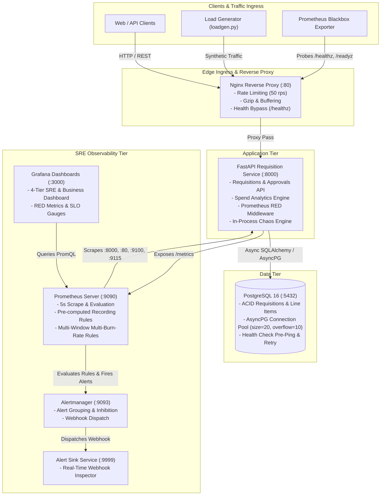

# Zycus ProcurePulse — System Architecture & Reliability Engineering

## 1. System Overview
**Zycus ProcurePulse** is an enterprise-grade Procurement Requisition and Purchase Order lifecycle service built with **FastAPI**, **PostgreSQL**, and an end-to-end **SRE Observability & Chaos Engineering** stack.

Designed specifically around the domain problems solved by **Zycus** (Cognitive Procurement & Spend Management), ProcurePulse models realistic enterprise procurement workflows (requisition drafting, line item aggregation, budget validation, multi-tier approvals, spend analytics) while upholding strict **99.9% 30-Day Availability Service Level Objectives (SLOs)**.

---

## 2. High-Level Architecture Diagram

---

## 3. Core Reliability Engineering Principles

### 3.1 Multi-Window Multi-Burn-Rate SLO Alerting (Google SRE Standard)
Rather than relying on naive static threshold alerts (e.g. `error_rate > 1% for 5m`) which generate alert fatigue during momentary blips and fail to catch slow catastrophic budget drains, ProcurePulse implements **Multi-Window Multi-Burn-Rate Alerting** based on *Google Site Reliability Engineering Workbook (Chapter 5)*:

$$\text{Burn Rate} = \frac{\text{Observed Error Ratio}}{1 - \text{SLO Target}} = \frac{\text{Observed Error Ratio}}{0.001}$$

| Alert Tier | Burn Rate | % Error Budget Consumed | Time to Budget Depletion | Long Window | Short Window | Severity |
| :--- | :---: | :---: | :---: | :---: | :---: | :---: |
| **Page Alert** | **14.4x** | 2.0% in 1 hour | 50 hours | **1 hour** | **5 minutes** | `page` (Critical) |
| **Ticket Alert** | **6.0x** | 5.0% in 6 hours | 120 hours | **6 hours** | **30 minutes** | `warning` (Ticket) |

**Dual-Window Verification**: An alert fires **only** if the error budget is burning in both the long window (ensuring statistical significance) **AND** the short window (ensuring the incident is active *right now* and has not already self-healed).

### 3.2 Pre-computed Recording Rules
Complex PromQL rate computations across 5m, 30m, 1h, and 6h windows are evaluated continuously as Prometheus recording rules (`job:http_error_ratio:rate5m`, `job:http_request_duration_seconds:p95`). This reduces query latency on dashboard refreshes and makes alerting rules deterministic.

### 3.3 Dynamic Chaos Engineering
The in-process Chaos Engine (`app/chaos/engine.py`) allows SREs to inject controlled production faults at runtime:
- **Synthetic Latency Injection**: Verifies p95/p99 latency alerts and client timeout resilience.
- **HTTP 500 Error Bursts**: Simulates downstream microservice outages and validates SLO burn-rate paging.
- **Database Connection Dropping**: Simulates PostgreSQL failure and tests `/readyz` health segregation.
- **Memory Pressure**: Simulates leaks to verify OOM prevention and container resource limits.
