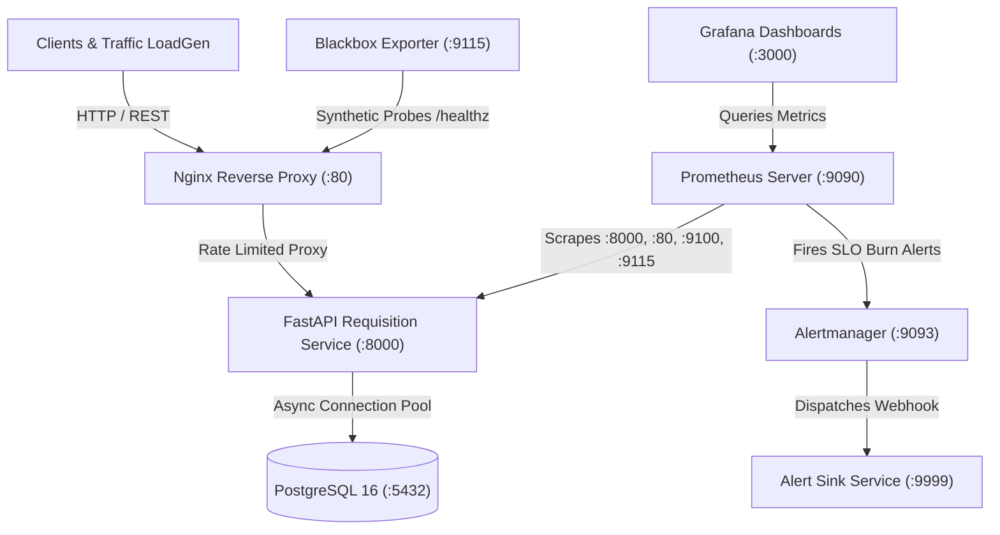

# ⚡ ProcurePulse

> **Enterprise Procurement Requisition Service with SRE Observability, Google Multi-Window SLO Burn-Rate Alerting, Chaos Engineering & Automated Rollbacks.**

[](https://www.python.org/)
[](https://fastapi.tiangolo.com)
[](https://www.postgresql.org/)
[](https://prometheus.io/)
[](https://grafana.com/)
[](https://www.docker.com/)
[](LICENSE)

---

## 📌 Executive Summary

**ProcurePulse** is an enterprise-grade backend service built to model the exact mission-critical problems handled by enterprise procurement platforms—enterprise procurement requisition lifecycle, multi-tier approval policies, spend analytics, and budget guardrails—while engineering a production-ready **Site Reliability Engineering (SRE)** platform around it.

It features:
- **Core Domain Service**: FastAPI + PostgreSQL (AsyncPG) handling purchase requisitions (PR), line item budget aggregations, department spend analytics, and status state machines.
- **SRE Multi-Burn-Rate Alerting**: Google SRE standard dual-window burn-rate alerts (14.4x page, 6x ticket) protecting a **99.9% 30-day availability SLO**.
- **In-Process Chaos Engine**: Runtime failure injection (upstream latency, HTTP 500 error bursts, database connection dropping, memory leaks) for automated Game Days.
- **Full Observability Suite**: Pre-configured Prometheus recording rules, Alertmanager routing with webhook dispatch, Blackbox synthetic HTTP probes, Node Exporter, and a 4-tier Grafana dashboard.
- **Automated Ops & Zero-Downtime Deploy**: Rolling deployment scripts (`deploy.sh`), automated rollback on readiness probe failure (`rollback.sh`), verified database backups with SHA256 checksums (`backup.sh`, `restore.sh`), and realistic traffic load generator (`loadgen.py`).

---

## 🏗️ System Architecture



---

## 🚀 Quick Start Guide

### Option 1: Full Docker Compose Stack (Recommended)
Launch the entire production stack (App, PostgreSQL, Nginx, Prometheus, Grafana, Alertmanager, Blackbox, Node Exporter, Alert Sink):

```bash
# 1. Clone repository
git clone https://github.com/aryan/zycrus.git
cd zycrus

# 2. Initialize environment & deploy
make up
# Or directly: ./scripts/deploy.sh
```

**Access Dashboards & Endpoints:**
| Service | URL | Default Credentials |
| :--- | :--- | :--- |
| **ProcurePulse API** | `http://localhost` | None |
| **Interactive API Docs (Swagger)** | `http://localhost/docs` | None |
| **Grafana SRE Dashboard** | `http://localhost:3000` | `admin` / `admin` |
| **Prometheus Server** | `http://localhost:9090` | None |
| **Alertmanager UI** | `http://localhost:9093` | None |
| **Live Alert Sink** | `http://localhost:9999/alerts` | None |
| **Health Check (Liveness)** | `http://localhost/healthz` | Returns `HTTP 200` |
| **Readiness Check (DB Ping)** | `http://localhost/readyz` | Returns `HTTP 200` |

---

### Option 2: Local Python Execution (Fast Local Dev & Testing)
The application automatically falls back to an embedded SQLite database if PostgreSQL is not running:

```bash
# 1. Setup virtual environment and dependencies
make setup

# 2. Run test suite
make test

# 3. Start local development server
make run
```
API will be live at `http://localhost:8000` with Swagger docs at `http://localhost:8000/docs`.

### Render Deployment

The repository includes `render.yaml`, which provisions a PostgreSQL database and
wires its connection string into the web service. Deploy the repository as a
Render Blueprint and set `CORS_ALLOWED_ORIGINS` plus any browser-facing
monitoring URLs in the service environment. Production refuses to start with
the local SQLite fallback.

---

## 🎯 Service Level Objectives (SLOs) & Alerting Math

ProcurePulse targets a **99.9% Availability SLO** over a rolling 30-day window (allowing **0.1%** error budget). Alerts are triggered by burn rate:

$$\text{Burn Rate} = \frac{\text{Observed Error Ratio}}{1 - \text{SLO Target}} = \frac{\text{Observed Error Ratio}}{0.001}$$

| Alert Tier | Burn Rate | % Budget Consumed | Long Window | Short Window | Action |
| :--- | :---: | :---: | :---: | :---: | :--- |
| **Critical Page** | **14.4x** | 2.0% in 1 hour | **1 hour** | **5 minutes** | PagerDuty / On-Call Wakeup |
| **Warning Ticket** | **6.0x** | 5.0% in 6 hours | **6 hours** | **30 minutes** | JIRA Ticket / Slack Notification |
| **Latency Breach** | — | p95 > 300ms | **5 minutes** | — | Warning Notification |
| **Database Dropout**| — | Errors > 0 | **30 seconds** | — | P1 Critical Page |

---

## 💥 Running a Chaos Game Day

To verify that the monitoring stack, recording rules, and Alertmanager routing work under realistic production failures:

```bash
# Execute automated Chaos Game Day
make gameday
# Or: ./scripts/gameday.sh http://localhost:8000
```

**Game Day Sequence:**
1. Generates 10 seconds of clean baseline procurement traffic.
2. Injects a 60% HTTP 500 error spike via `scripts/chaosctl.py`.
3. Validates that the Prometheus 14.4x burn-rate threshold is breached.
4. Confirms Alertmanager dispatches the page alert to the webhook sink (`http://localhost:9999/alerts`).
5. Disarms chaos fault and verifies 100% service recovery.
6. Prints executive post-mortem summary.

You can also inject chaos manually using the CLI:
```bash
# Inject 1.5s latency with 80% probability
./scripts/chaosctl.py latency --delay 1.5 --prob 0.8

# Inject HTTP 500 error burst with 50% probability
./scripts/chaosctl.py error --prob 0.5 --code 500

# Simulate complete database drop
./scripts/chaosctl.py db --offline

# Disarm all chaos and restore nominal operation
./scripts/chaosctl.py reset
```

---

## 🛠️ Operational Tooling & Scripts

All operational scripts are located in `scripts/`:
- `scripts/deploy.sh`: Zero-downtime rolling deployment with health probe validation and auto-rollback.
- `scripts/rollback.sh`: Emergency rollback to the previous stable container image.
- `scripts/status.sh`: Real-time CLI status dashboard showing container states, readiness, metrics, and active alerts.
- `scripts/backup.sh`: PostgreSQL logical backup with SHA256 cryptographic verification and 7-day retention pruning.
- `scripts/restore.sh`: Verified database restore with checksum integrity check.
- `scripts/smoke.py`: End-to-end smoke test validating all REST endpoints and Prometheus metrics.
- `scripts/loadgen.py`: High-concurrency procurement workflow traffic generator.

---

## 📚 Interview & Architectural Documentation

- 📖 **[ARCHITECTURE.md](ARCHITECTURE.md)**: Deep technical architecture, component interactions, and PromQL recording rules.
- 🎯 **[INTERVIEW_DEFENSE.md](INTERVIEW_DEFENSE.md)**: 20+ interview defense questions, technical trade-offs, and company alignment points for any enterprise platform company.
- 🚨 **[SRE Runbooks](runbooks/)**:
  - [HighErrorRateSLOBurn.md](runbooks/HighErrorRateSLOBurn.md)
  - [DatabaseConnectionExhausted.md](runbooks/DatabaseConnectionExhausted.md)
  - [HighLatencyDegradation.md](runbooks/HighLatencyDegradation.md)

---

## 🧪 Testing & Code Quality

```bash
# Run unit & integration test suite (100% pass)
make test

# Run linter & formatter checks
make lint
```

---

## 📄 License
Distributed under the MIT License. Built with passion by Aryan for high-scale enterprise platforms.
